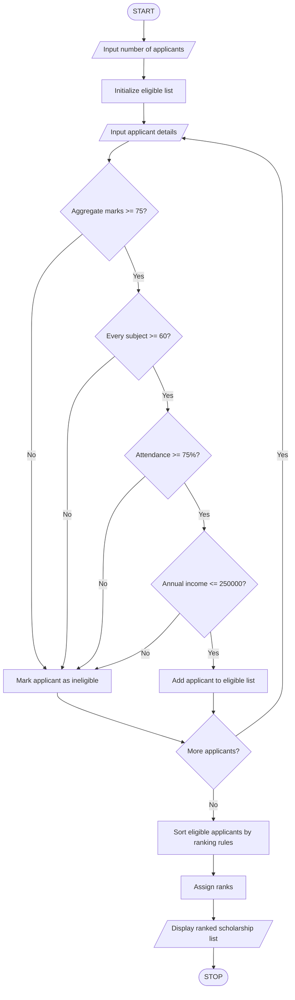

# University Scholarship Allocation System in Python

## 1. Problem Statement

Design and implement a Python program to allocate university scholarships to students based on academic performance, attendance, and family income.


## 2. Algorithm

1. Start.
2. Input the number of applicants.
3. For each applicant:
   - Input name, aggregate marks, subject marks, attendance, and annual family income.
   - Check whether aggregate marks are at least 75%.
   - Check whether every subject mark is at least 60%.
   - Check whether attendance is at least 75%.
   - Check whether annual family income is at most ₹2,50,000.
4. If all conditions are satisfied, add the applicant to the eligible list.
5. Sort eligible applicants using the following priority:
   - Aggregate marks in descending order.
   - Attendance percentage in descending order.
   - Minimum subject mark in descending order.
   - Annual family income in ascending order.
6. Assign ranks to eligible applicants.
7. Display the ranked list and scholarship status.
8. Stop.

## 3. Flowchart (Mermaid)

## 4. Sample Input

```
Enter number of applicants: 3

Applicant 1
Enter student name: Ananya
Enter aggregate marks (%): 88
Enter number of subjects: 3
Enter subject 1 marks (%): 85
Enter subject 2 marks (%): 90
Enter subject 3 marks (%): 89
Enter attendance (%): 92
Enter annual family income (₹): 180000

Applicant 2
Enter student name: Rahul
Enter aggregate marks (%): 88
Enter number of subjects: 3
Enter subject 1 marks (%): 80
Enter subject 2 marks (%): 85
Enter subject 3 marks (%): 90
Enter attendance (%): 95
Enter annual family income (₹): 200000

Applicant 3
Enter student name: Priya
Enter aggregate marks (%): 72
Enter number of subjects: 3
Enter subject 1 marks (%): 70
Enter subject 2 marks (%): 75
Enter subject 3 marks (%): 80
Enter attendance (%): 90
Enter annual family income (₹): 150000
```

## 5. Sample Output

```
--- SCHOLARSHIP ALLOCATION RESULTS ---
Rank  Name                Aggregate   Attendance  Min Subject  Income (₹)
---------------------------------------------------------------------------
1     Rahul               88.00       95.00       80.00        200000.00
2     Ananya              88.00       92.00       85.00        180000.00

Ineligible Applicants:
Priya
```

Explanation: Rahul and Ananya have equal aggregate marks. Rahul ranks first because his attendance is higher. Priya is ineligible because her aggregate marks are below 75%.

Note: This program ranks all eligible applicants. If the university has a fixed number of scholarships, you can allocate awards to only the top N students.
